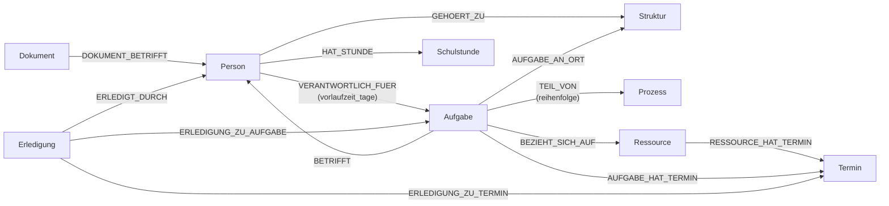

# Ontologie-Design: Haushalt

Ontologie für Struktur, Prozesse, Personen und Aufgaben im Haushalt, implementiert als
Graphdatenbank (Kùzu). Ziel: Grundlage für eine KI, die Personen proaktiv an anstehende
Aufgaben erinnert (siehe `digest.py`).

## Diagramm

`Termin` trägt `datum`, `ort`, `beginn` (HH:MM, leer = ganztägig) und `dauer_minuten`.
`Schulstunde` trägt `wochentag`, `stunde`, `fach`, `raum`, `lehrer`, `woche` (leer/A/B),
`beginn`, `ende` und `quelle`. `Dokument` trägt `titel`, `typ`, `quelle`, `datum`, `text`.

## Modellierungsentscheidungen

**Termine als konkrete Datumsinstanzen, nicht als Wiederholungsregel.**
Der reale Müllkalender des Nutzers zeigt unregelmäßige Abstände (feiertagsbedingte
Verschiebungen wie an Allerheiligen). Ein "alle X Wochen"-Feld könnte das nicht abbilden.
Stattdessen wird `Termin` als konkretes Datum gespeichert; ein Helper-Skript generiert bei
Bedarf mehrere `Termin`-Knoten im Voraus (z.B. für die nächsten Wochen/Monate). Das hält
Abfragen (und den Digest-Export) auf einen einfachen Datumsbereich-Filter reduziert.

**Ressource-Code ist Farbe + Buchstabe, nicht nur Buchstabe.**
Im realen Müllkalender ist "C" mehrdeutig: schwarzes C = Restmüll, gelbes C = Gelber Sack,
grünes C = Papiertonne. Der `Ressource`-Knoten trägt deshalb sowohl `farbe` als auch
`kalender_code` als getrennte Properties.

**Vorlaufzeit ist eine Eigenschaft der Beziehung, nicht des Knotens.**
`vorlaufzeit_tage` sitzt auf der Kante `VERANTWORTLICH_FUER` zwischen `Person` und
`Aufgabe`, nicht auf der `Aufgabe` selbst — verschiedene Personen können unterschiedlich
früh an dieselbe Aufgabe erinnert werden wollen.

**Betroffene getrennt von Zuständigen.**
`VERANTWORTLICH_FUER` (Person → Aufgabe) beantwortet "wer macht es", `BETRIFFT`
(Aufgabe → Person) beantwortet "um wen geht es". Bei "Max bringt Lena zum Hautarzt"
wären beide in einer Kante nicht unterscheidbar — Lena stünde als Erledigende im Modell,
und die Frage "was steht für Lena an" würde ihren eigenen Arzttermin nicht finden.

**Ort und Dauer am Termin, nicht an der Aufgabe.**
Dieselbe Aufgabe kann an verschiedenen Terminen unterschiedlich lange dauern und an
verschiedenen Orten stattfinden. Erst mit `ort` wird aus "Termin am 02.10." die
ableitbare Konsequenz "jemand muss ins Allgäu fahren".

**Uhrzeit als Text, nicht als TIMESTAMP.**
`beginn` ist `HH:MM` (leer = ganztägig). Ein `TIMESTAMP` hätte `datum` als einzigen
Schlüssel für Zeitfensterabfragen ersetzt und alle Bestandstermine (Müllkalender,
Kalender-Import) betroffen — für den einzigen Gewinn, Uhrzeit und Datum in einem Feld zu
halten.

**Schulstunde ist kein Termin.**
Ein Stundenplan wiederholt sich wöchentlich und hat kein Datum. `Schulstunde` trägt
deshalb `wochentag` und `stunde` statt eines Datums. Als Termine ausmodelliert ergäbe ein
Schuljahr ~1200 Knoten pro Kind — die gleiche Überlegung wie beim Müllkalender, nur mit
umgekehrtem Ergebnis: dort sind die Abstände unregelmäßig und rechtfertigen konkrete
Daten, hier ist der Rhythmus starr.

**Extraktion im Modell, Prüfung im Server.**
Ein Stundenplan-PDF liest das Sprachmodell (Claude Desktop sieht Bild und Text), nicht
der Server. Der Server prüft dafür streng und vollständig, bevor er schreibt: Wochentag,
Uhrzeiten, Reihenfolge von Beginn und Ende, doppelt belegte Plätze im Raster. Doppelt
belegte Plätze sind fast immer Lesefehler — oder ein A/B-Rhythmus, den das Modell noch
nicht als solchen markiert hat; die Fehlermeldung sagt beides.

**Das Quelldokument ist ein Knoten, nicht nur ein Dateiname.**
`Dokument` hängt über `DOKUMENT_BETRIFFT` an der Person und trägt den Text, der nicht in
Felder passt. Damit bleibt jede übernommene Information auf ihre Herkunft zurückführbar,
und Fragen wie "Wer ist Nicos Klassenlehrerin?" lassen sich über Graph *und* Text
beantworten.

**Schema-Änderungen als Migration, nicht als Neuaufbau.**
`schema.py` enthält das gesamte Schema idempotent; `app.py` führt es bei jedem Start aus.
Vorher hätte jede Erweiterung bedeutet, die Datenbank zu löschen — samt Müllkalender und
Kalender-Import.

**Kalender-Sync als Abgleich, nicht als Neuaufbau.**
Die Aufgaben-ID wird aus der Kalender-UID abgeleitet und bleibt damit über Läufe hinweg
stabil. Dadurch lässt sich ein bestehendes Ereignis wiedererkennen, statt es zu löschen
und neu anzulegen — und nur deshalb überleben von Hand gesetzte Zuständigkeiten und
Betroffene einen Sync. Der Kalender liefert Titel und Termine, alles andere gehört dem
Haushalt.

**Erledigt wird gespeichert, verpasst wird abgeleitet.**
Eine `Erledigung` hängt an Aufgabe und Termin (ein Mülltermin gehört der Tonne, nicht der
Aufgabe) und optional an der Person, die es erledigt hat — als Kante, damit sich fragen
lässt, wer wie viel im Haushalt macht. Gespeichert werden nur `erledigt` und `entfaellt`.
`offen`, `verpasst` und `unbekannt` ergeben sich aus Datum und Erfassungsbeginn; ein
gespeichertes "verpasst" bräuchte einen Prozess, der um Mitternacht umstempelt.

**Erinnerungen planen in ontoFam, zustellen in Home Assistant.**
Wer wann woran erinnert wird, folgt aus der Ontologie (Zuständigkeit, Vorlaufzeit,
Status) und gehört deshalb hierher. Zugestellt wird über die Companion-App von Home
Assistant, in Richtung ontoFam → Home Assistant: so muss die Haushaltsdatenbank im
Heimnetz nicht erreichbar sein. Das Protokoll gesendeter Erinnerungen ist
Betriebszustand, kein Haushaltswissen — `Erinnerung`-Knoten haben deshalb keine Kanten.

**Home Assistant als Add-on, nicht als eigene VM.**
ontoFam läuft als lokales Add-on neben Home Assistant statt in einem eigenen
Proxmox-Container. So kommen Anmeldung (Seitenleiste), Backups und das Token für
Benachrichtigungen von Home Assistant, statt dreimal selbst gebaut zu werden. Der Preis:
ein Debian-Image statt des üblichen Alpine, weil es Kùzu nur für glibc gibt.

**Termine sind langlebig.** Weil an Terminen Erledigungen hängen, werden sie nicht mehr
neu angelegt: Kalender-Sync und Müllkalender-Import gleichen ab und löschen nur im
Zeitraum, für den ihre Quelle vollständig ist. Vergangenes bleibt als Verlauf.

**Rohdaten getrennt vom Code.**
Der Müllkalender liegt als `data/muellkalender.csv` + `data/tonnenarten.json` vor, nicht
hartkodiert in `load_data.py`. Ein neues Kalenderjahr = neue CSV, keine Codeänderung.

## Warum Kùzu

Eingebettete, dateibasierte Graphdatenbank mit openCypher-Syntax (`pip install kuzu`,
kein Server/Docker nötig). Modell ist bei Bedarf leicht nach Neo4j portierbar, da die
Cypher-Syntax praktisch identisch ist.
